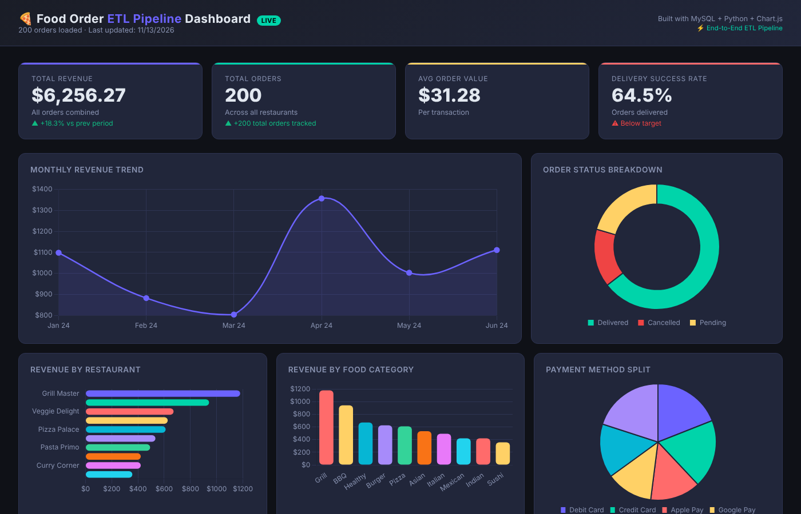

# 🍕 Food Order ETL Pipeline

<div align="center">


**A production-style, end-to-end data engineering pipeline for food delivery analytics.**

[Live Dashboard](#-dashboard-preview) · [Architecture](#-architecture) · [Setup](#-quick-start) · [Tech Stack](#-tech-stack)

> 💼 **Need an ETL pipeline built for your data?** [Hire me on Upwork](https://www.upwork.com/services/product/development-it-end-to-end-food-order-etl-pipeline-mysql-python-power-bi-2070932638680691364)

</div>

---

## 📌 What This Project Demonstrates

This project models the kind of ETL workflow a food delivery business uses to move raw order data from ingestion through to business intelligence dashboards. It runs on 200 simulated orders, so you can clone it and see every layer working in a few minutes.



Key skills demonstrated:

- **Staging → Warehouse architecture** (industry-standard two-layer design)
- **MySQL Stored Procedures** for scalable, reusable transformation logic
- **Star Schema** data warehouse design (`fact_orders` + 4 dimension tables)
- **Idempotent pipeline** — safe to re-run; never creates duplicate data
- **ETL Job Logging** — every run is audited in `etl_job_log`
- **Python ETL orchestration** with structured logging
- **Unit testing** with 20 automated data quality tests
- **CI/CD** via GitHub Actions
- **Interactive HTML Dashboard** — viewable without any BI tool

---

## 🏗 Architecture

```
┌─────────────────────────────────────────────────────────────────────┐
│                     FOOD ORDER ETL PIPELINE                         │
│                                                                     │
│  ┌──────────┐    ┌──────────┐    ┌─────────────────────────────┐   │
│  │          │    │          │    │   food_order_staging (MySQL) │   │
│  │  CSV /   │───▶│ extract  │───▶│   ┌─────────────────────┐   │   │
│  │  Source  │    │  .py     │    │   │ stg_orders          │   │   │
│  │          │    │          │    │   │ etl_job_log         │   │   │
│  └──────────┘    └──────────┘    │   └─────────────────────┘   │   │
│                                  └──────────────┬──────────────┘   │
│                                                 │                   │
│                                  Stored Procedures (sp_run_full_etl)│
│                                                 │                   │
│                                  ┌──────────────▼──────────────┐   │
│                                  │  food_order_warehouse (MySQL)│   │
│                                  │  ┌──────────────────────┐   │   │
│                                  │  │  fact_orders         │   │   │
│                                  │  ├──────────────────────┤   │   │
│                                  │  │  dim_customers       │   │   │
│                                  │  │  dim_restaurants     │   │   │
│                                  │  │  dim_food_items      │   │   │
│                                  │  │  dim_date            │   │   │
│                                  │  └──────────────────────┘   │   │
│                                  └──────────────┬──────────────┘   │
│                                                 │                   │
│                                  ┌──────────────▼──────────────┐   │
│                                  │  Power BI / HTML Dashboard   │   │
│                                  │  Revenue · Orders · Ratings  │   │
│                                  └─────────────────────────────┘   │
└─────────────────────────────────────────────────────────────────────┘
```

---

## 📁 Project Structure

```
Food-order-ETL-pipeline/
│
├── data/
│   └── raw/
│       └── food_orders_raw.csv        ← 200 simulated food orders
│
├── sql/
│   ├── 01_create_staging_db.sql       ← Staging tables + etl_job_log
│   ├── 02_create_warehouse_db.sql     ← Star schema + dim_date population
│   ├── 03_stored_procedures.sql       ← 5 stored procedures (upsert logic)
│   └── 04_sample_queries.sql          ← Business analytics queries
│
├── etl/
│   ├── config.py                      ← DB connection settings
│   ├── extract.py                     ← Read raw CSV → list of dicts
│   ├── load_staging.py                ← Insert into stg_orders (skip duplicates)
│   ├── transform.py                   ← Call sp_run_full_etl via Python
│   ├── pipeline.py                    ← 🚀 Main runner — orchestrates everything
│   └── requirements.txt              ← mysql-connector-python, python-dotenv
│
├── scripts/
│   └── generate_data.py              ← Generate N fake orders (seed-reproducible)
│
├── tests/
│   └── test_extract.py               ← 20 unit tests (data quality + module)
│
├── dashboard/
│   └── index.html                    ← Interactive analytics dashboard (no BI tool!)
│
├── powerbi/
│   └── POWERBI_GUIDE.md              ← Step-by-step Power BI connection guide
│
├── .github/
│   └── workflows/
│       └── ci.yml                    ← GitHub Actions CI (runs on every push)
│
├── Makefile                          ← make install / run / test / generate
└── README.md
```

---

## ⚡ Quick Start

### Prerequisites

| Tool | Version | Download |
|------|---------|----------|
| MySQL | 8.0+ | [mysql.com](https://dev.mysql.com/downloads/mysql/) |
| Python | 3.8+ | [python.org](https://www.python.org/downloads/) |
| Power BI Desktop *(optional)* | Latest | [powerbi.microsoft.com](https://powerbi.microsoft.com/desktop) |

---

### 1 · Clone the repository

```bash
git clone https://github.com/anupkatuwal/food-order-etl-pipeline.git
cd food-order-etl-pipeline
```

### 2 · Install Python dependencies

```bash
make install
# or manually: pip install -r etl/requirements.txt
```

### 3 · Configure your MySQL connection

Edit `etl/config.py`:

```python
DB_CONFIG = {
    "host":     "localhost",
    "port":     3306,
    "user":     "root",
    "password": "yourpassword"   # ← update this
}
```

### 4 · Set up the databases

Run these SQL files **in order** in MySQL Workbench (File → Open SQL Script → ⚡ Execute):

```
sql/01_create_staging_db.sql     →  Creates food_order_staging
sql/02_create_warehouse_db.sql   →  Creates food_order_warehouse (star schema)
sql/03_stored_procedures.sql     →  Creates 5 transformation procedures
```

### 5 · Run the ETL pipeline

```bash
make run
# or: cd etl && python pipeline.py
```

Expected output:
```
============================================================
  FOOD ORDER ETL PIPELINE — STARTING
============================================================
STEP 1: Extracting data from CSV...
  ✓ Extracted 200 rows
STEP 2: Loading data into staging database...
  ✓ 200 new rows loaded into stg_orders
  ✓ 200 unprocessed rows in staging
STEP 3: Running transformations (staging → warehouse)...
  ✓ Warehouse updated successfully
============================================================
  PIPELINE COMPLETE in 3.4 seconds
  Rows extracted  : 200
  Rows to staging : 200
============================================================
```

### 6 · View the dashboard

Open `dashboard/index.html` in any browser — **no Power BI required**:

```bash
open dashboard/index.html      # macOS
start dashboard/index.html     # Windows
xdg-open dashboard/index.html  # Linux
```

### 7 · Verify the data in MySQL

```sql
USE food_order_warehouse;
SELECT COUNT(*) FROM fact_orders;       -- 200 rows
SELECT COUNT(*) FROM dim_customers;     -- 30 unique customers
SELECT COUNT(*) FROM dim_restaurants;   -- 10 restaurants

USE food_order_staging;
SELECT * FROM etl_job_log ORDER BY job_id DESC LIMIT 5;   -- shows SUCCESS
```

---

## 🧪 Running Tests

```bash
make test
# or: python -m pytest tests/ -v
```

**20 tests** covering:
- CSV file structure & column presence
- Data quality (unique IDs, valid emails, positive amounts)
- Business rule validation (cancelled orders have no driver)
- Math integrity (total = qty × unit_price)
- Module-level extract function behaviour

---

## 📊 Dashboard Preview

The `dashboard/index.html` file provides a fully interactive analytics view:

| Metric | Chart Type |
|--------|-----------|
| Total Revenue · Orders · AOV · Delivery Rate | KPI Cards |
| Monthly Revenue Trend | Line Chart |
| Order Status Breakdown | Donut Chart |
| Revenue by Restaurant | Horizontal Bar |
| Revenue by Food Category | Bar Chart |
| Payment Method Split | Pie Chart |
| Avg Customer Rating | Bar Chart |
| Orders by City | Donut Chart |
| Recent Orders | Sortable Table |

---

## 🗄 Database Design

### Staging Layer (`food_order_staging`)

| Table | Purpose |
|-------|---------|
| `stg_orders` | Raw order data exactly as received; `is_processed` flag tracks what's been loaded |
| `etl_job_log` | Audit log — records every pipeline run with status, timing, and error messages |

### Warehouse Layer (`food_order_warehouse`) — Star Schema

| Table | Type | Key Column |
|-------|------|-----------|
| `fact_orders` | Fact | `source_order_id` (surrogate key joins) |
| `dim_customers` | Dimension | `customer_key` |
| `dim_restaurants` | Dimension | `restaurant_key` |
| `dim_food_items` | Dimension | `food_item_key` |
| `dim_date` | Dimension | `date_key` (YYYYMMDD integer) |

### Stored Procedures

| Procedure | What It Does |
|-----------|-------------|
| `sp_load_dim_customers` | Upserts customers (INSERT … ON DUPLICATE KEY UPDATE) |
| `sp_load_dim_restaurants` | Upserts restaurants |
| `sp_load_dim_food_items` | Upserts menu items |
| `sp_load_fact_orders` | Joins staging → dims, inserts to fact table |
| `sp_mark_staging_processed` | Marks staging rows as `is_processed = 1` |
| `sp_run_full_etl` | **Master procedure** — calls all above in a transaction |

---

## 🛠 Tech Stack

| Layer | Technology | Why |
|-------|-----------|-----|
| Data Storage | MySQL 8.0 | Industry-standard relational database |
| Transformation | MySQL Stored Procedures | Business logic lives in DB, not scattered in scripts |
| Orchestration | Python 3 | Cross-platform ETL runner with logging |
| Schema Design | Star Schema | Optimised for analytical queries |
| BI Reporting | Power BI Desktop | Industry-standard BI tool |
| Web Dashboard | HTML + Chart.js | Zero-install analytics preview |
| Testing | pytest | 20 data quality & unit tests |
| CI/CD | GitHub Actions | Automated test runs on every push |

---

## 🔑 Key Concepts

| Concept | Explanation |
|---------|------------|
| **ETL** | Extract, Transform, Load — the 3-step data pipeline pattern |
| **Staging DB** | Raw data as received; never modified after loading |
| **Warehouse DB** | Cleaned, modelled, analytics-ready data |
| **Star Schema** | One central fact table surrounded by descriptive dimension tables |
| **Upsert** | Insert if new, update if already exists — avoids duplicates |
| **Idempotent** | Running the pipeline multiple times produces the same result |
| **Surrogate Key** | Auto-generated integer PK used in the warehouse (vs. natural business keys) |
| **ETL Job Log** | Audit trail — who ran what, when, and whether it succeeded |

---

## 🔄 Adding New Data

1. Add rows to `data/raw/food_orders_raw.csv`
   — or run `python scripts/generate_data.py --rows 500` to generate more
2. Run `python etl/pipeline.py` (or `make run`)
3. The pipeline is **idempotent** — only new rows are loaded, no duplicates
4. Refresh Power BI / reload `dashboard/index.html` to see updated charts

---

## 📄 License

MIT License — free to use, modify, and distribute.

---

<div align="center">

**Built by [Anup Katuwal](https://anup-katuwal.com.np)** · [LinkedIn](https://linkedin.com/in/anupkatuwal89) · [More projects](https://github.com/anupkatuwal)

*Data Engineer · MySQL · Python · Power BI · ETL Pipelines*

</div>
